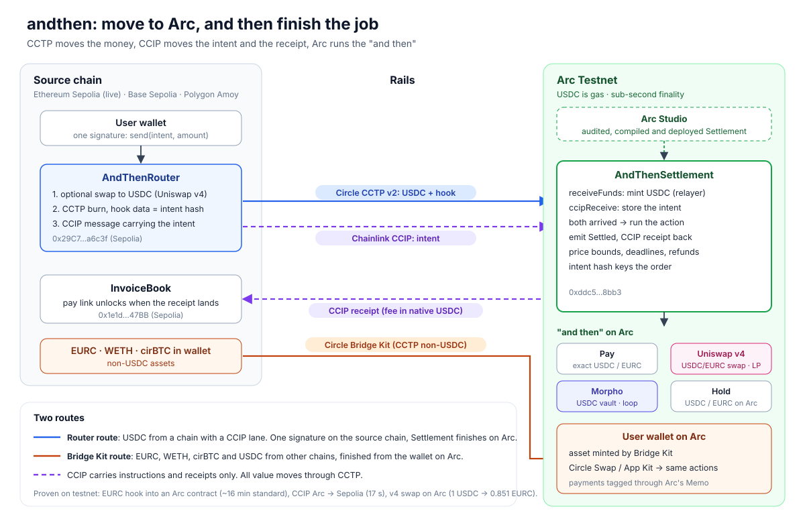

# andthen

Nobody bridges for fun. There is always an "and then": pay someone, get paid, earn, put it in a pool. Bridges stop at "funds arrived". andthen finishes the job on Arc.

The whole app is one sentence:

> Move 10 USDC from Base to Arc, and then pay alex.eth 9 EURC.

Every part of it is a dropdown. "and then" is fixed. The panel on the side lists what can come next and fills the sentence when you pick one.

## Built in Arc Studio

**Bounty:** Best Use of Bridge Kit for Non-USDC Assets, Built in Arc Studio.

**Arc Studio project:** https://studio.arc.io/app/cb20c8eb-57e8-49eb-abda-1c60be57f23f

- **Settlement, our main Arc contract, was compiled and deployed by Arc Studio.** Studio's workspace has no Chainlink, Uniswap v4 or Permit2 packages, so we flattened `src/AndThenSettlement.sol` into [`studio/AndThenSettlement.flat.sol`](studio/AndThenSettlement.flat.sol) and sent it with the Arc Studio CLI. Studio compiled it (0.8.28, viaIR, optimizer 200, cancun) and deployed it on Arc Testnet. The on-chain runtime is byte-for-byte the size of our local, tested build. Steps and prompt: [`studio/README.md`](studio/README.md).
- **Arc Studio audited every contract.** Report and fixes: [AUDIT.md](AUDIT.md).
- **Arc Studio also deployed `HookReceiver`**, the receiver we used to prove EURC with hook data lands in an Arc contract (CCTP for non-USDC assets).
- **Bridge Kit for non-USDC assets:** EURC, WETH and cirBTC are bridged with Circle Bridge Kit and finished on Arc (see "How it works").

## Deployed contracts (testnet)

| Chain | Contract | Address | Deployed with |
|---|---|---|---|
| Arc Testnet | AndThenSettlement | [`0xddc5b10c8e8001d5bd385025ad9dfc6a56d38bb3`](https://explorer.testnet.arc.io/address/0xddc5b10c8e8001d5bd385025ad9dfc6a56d38bb3) | **Arc Studio** |
| Arc Testnet | HookReceiver (EURC hook test) | [`0x86f5d77bDb889Ec3B4550049fCbF79265Ede5012`](https://explorer.testnet.arc.io/address/0x86f5d77bDb889Ec3B4550049fCbF79265Ede5012) | **Arc Studio** |
| Ethereum Sepolia | AndThenRouter | [`0x29C7119964c2aa6cB66Ade33D73832c9c7da6c3f`](https://sepolia.etherscan.io/address/0x29C7119964c2aa6cB66Ade33D73832c9c7da6c3f) | `forge script` (DeploySource) |
| Ethereum Sepolia | InvoiceBook | [`0x1e1d833F54E6a4bDC225Be7077f123eb467447BB`](https://sepolia.etherscan.io/address/0x1e1d833F54E6a4bDC225Be7077f123eb467447BB) | `forge script` (DeploySource) |

Settlement is set up with the Morpho USDC vault, the USDC/EURC v4 pool and the Sepolia router (`setVault`, `setPool`, `setSource`). Every other address we use (CCTP, CCIP, Uniswap v4, tokens) is in [ADDRESSES.md](ADDRESSES.md).

### Rails we proved on testnet first

| Rail | Result | Script |
|---|---|---|
| EURC Sepolia → Arc with hook data (CCTP for non-USDC) | landed in `HookReceiver`, hook data decoded, ~16 min at standard finality | [`scripts/eurc-hook`](scripts/eurc-hook/README.md) |
| CCIP message Arc → Sepolia, fee in native USDC | delivered in **17 s** | `scripts/ccip-hello` |
| Uniswap v4 swap on Arc's USDC/EURC pool | 1 USDC → 0.851 EURC | `scripts/uniswap-swap` |

## Main use case: pay links

A merchant requests 25 EURC on Arc and gets a link. The payer opens it, pays from Base, and the merchant receives exactly 25 EURC on Arc, tagged with the invoice id. The invoice on Base only unlocks when a receipt from Arc arrives.

## How it works



```
Base Sepolia                                   Arc testnet
AndThenRouter                                  AndThenSettlement
  swap input to USDC (Uniswap v4, optional)
  CCTP burn, hook data = intent id   ───────▶  receiveFunds: mint USDC
  CCIP message with the intent       ───────▶  ccipReceive: store intent
                                               both here: run the action
                                                 pay exact USDC
                                                 pay exact EURC via the v4 pool
                                                 swap everything into EURC
                                                 add liquidity to the v4 pool
                                                 lend on Morpho
InvoiceBook                                    emit Settled(id, invoiceId, ...)
  ccipReceive: unlock the invoice    ◀───────  CCIP receipt
```

- **CCTP moves the money, CCIP moves the instructions and the receipt.** CCIP can not carry value to Arc for us, so all value goes through CCTP. The two arrive in either order; the settlement contract matches them by intent id, which travels as CCTP hook data. The CCTP sender is checked against our router.
- **Two onchain state changes over CCIP.** The intent changes state on Arc, and the receipt unlocks the invoice on Base.
- **Uniswap is a destination, not only a source.** The settlement contract swaps through the USDC/EURC v4 pool on Arc to pay an exact EURC amount or convert everything into EURC, and it can put the funds into that pool: half is swapped into EURC and a full-range position is minted to the user through PositionManager. The router can also swap any token with a v4 pool against USDC on Base before bridging.
- **Many chains, two routes.** USDC from Base, Ethereum or Polygon (the chains with a CCIP lane to Arc) runs through our router and settlement contract. USDC from Arbitrum, Optimism, Avalanche, Unichain, Linea, World Chain, Ink, Sonic or Monad, and EURC, WETH and cirBTC, are bridged with Bridge Kit and finished from the wallet on Arc with Circle's kits.
- **Real numbers from mainnet.** Next to the testnet flow the app shows Arc mainnet figures: the best Morpho vaults and borrow markets from Circle's kits, and the Uniswap USDC/EURC pool's fee APR from its last 24 hours of swaps. Probing every token Morpho lists on Arc against USDC and EURC across all fee tiers finds no other hookless Uniswap v4 pool between real assets yet.
- **Numbers before you sign.** Vault APY and liquidity, the borrow market's rate and LLTV, and USD prices come live from Circle App Kit; the pool price and in-range depth come from the v4 StateView. The app shows rate, cost, loan to value and liquidation price for the option you pick.
- **Lend and loop on Morpho.** USDC can land straight in a Morpho USDC vault on Arc (one of the vaults Circle Earn lists), with the shares going to the user. Any asset can be looped into BTC: it is swapped into cirBTC, Circle Borrow takes it as collateral on Morpho, the borrowed USDC buys more cirBTC through Circle Swap and goes back into the same loan, round after round until the chosen leverage.
- **Bridge Kit for non-USDC assets.** WETH and cirBTC (from Ethereum Sepolia) and EURC (from Base or Ethereum) are bridged natively with Circle Bridge Kit. The "and then" runs from the user's wallet on Arc. Payments go through Arc's `Memo` contract, which only accepts calls from an EOA.
- **Exact amounts, bounded prices.** Pay actions deliver exactly the requested amount. Every swap carries a price bound and every intent a deadline. Whatever is left after the CCTP fee, the swap and the receipt fee goes back to the payer on Arc. If the action can not run, everything is refunded and a failed receipt goes back.
- **Funds only settle their own intent.** Orders are keyed by the hash of the whole intent, and the CCTP burn carries that hash.

## Chain facts that shaped the design

- CCIP lanes to Arc testnet exist for Base Sepolia, Ethereum Sepolia and Polygon Amoy, not Arbitrum or Optimism. They are CCIP 2.0, so messages use `ExtraArgsV3`.
- Base to Arc accepts block-depth finality. The router asks for 5 blocks and the settlement contract allows it through `getCCVsAndFinalityConfig`, so the intent does not wait for full finality.
- Arc to Base fees can not be paid with the USDC ERC20 (`TokenNotSupported`), but native value works. On Arc native value is USDC with 18 decimals, so receipts are paid in native USDC.
- Arc's `Memo` contract reverts when called by a contract. The settlement contract emits its own `Settled` event with the invoice id instead.

## Repository

| Path | What |
| - | - |
| `src/AndThenSettlement.sol` | Arc. Pairs CCTP funds with CCIP intents, runs the action, sends the receipt |
| `src/AndThenRouter.sol` | Source chain. Optional v4 swap, CCTP burn with hook, CCIP intent |
| `src/InvoiceBook.sol` | Source chain. Invoices unlocked by CCIP receipts |
| `src/UniswapV4Swapper.sol` | Exact-in and exact-out swaps straight against the v4 PoolManager |
| `test/AndThen.t.sol` | Full flow against a real v4 PoolManager with CCTP and CCIP mocks |
| `script/Deploy.s.sol` | Deploy and wire up on Arc testnet and Base Sepolia |
| `src/HookReceiver.sol` | Arc. Test receiver for EURC with hook data (`executeWithCrossChainToken`), deployed in Arc Studio |
| `studio/` | Flattened Settlement for Arc Studio, the deploy prompt, and how to redeploy |
| `scripts/settlement-setup` | Owner setup after the Studio deploy (`setVault`, `setPool`) |
| `scripts/eurc-hook`, `scripts/ccip-hello`, `scripts/uniswap-swap` | The rail tests: EURC hook, CCIP Arc → Sepolia, v4 swap on Arc |
| `deployments/`, `ADDRESSES.md`, `broadcast/` | Every deployed and external address, and the forge deploy logs |
| `assets/architecture.svg` | Architecture diagram |
| `web/` | Next.js app: the sentence, pay links, and the CCTP relayer route |

## Run it

```bash
npm install                 # Chainlink CCIP contracts
forge test
```

Deploy, with `PRIVATE_KEY` and `DEPLOYER` in `.env`:

```bash
source .env
forge script script/Deploy.s.sol:DeployArc --rpc-url arc_testnet --broadcast --private-key $PRIVATE_KEY
# once per source chain: SOURCE is base, sepolia or amoy, with the matching --rpc-url
SOURCE=base SETTLEMENT=0x... forge script script/Deploy.s.sol:DeploySource --rpc-url base_sepolia --broadcast --private-key $PRIVATE_KEY
SOURCE=base SETTLEMENT=0x... ROUTER=0x... forge script script/Deploy.s.sol:ConnectArc --rpc-url arc_testnet --broadcast --private-key $PRIVATE_KEY
```

Web app, with the deployed addresses in `web/.env.local` (see `web/.env.example`):

```bash
cd web
npm install
npm run dev
```

## Security

The contracts were audited with [Arc Studio](https://studio.arc.io): 3 high, 6 medium and 6 low findings. Every high and medium finding is fixed with a regression test, and so are most low ones. The report and our response are in [AUDIT.md](AUDIT.md).

## AI use

See [AI_USAGE.md](AI_USAGE.md).
